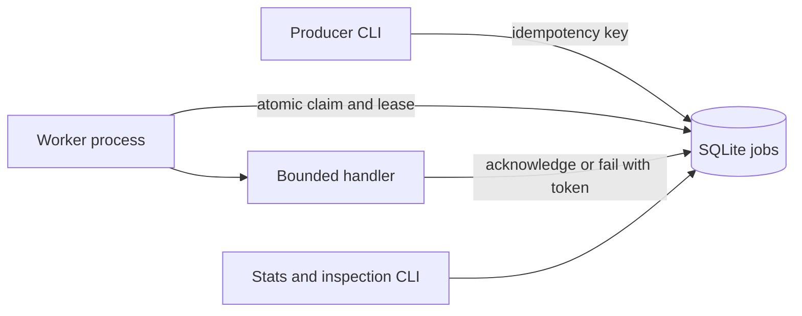

# Durable Queue

A Python and SQLite job queue that demonstrates how background work recovers after failure. Submit jobs with idempotency keys, run competing local workers, and inspect retries or dead-letter jobs. The included handlers transform text and sum numbers using synthetic inputs.

**Status:** Implemented local portfolio project, created with Codex during this portfolio-building task. It has no production deployments or claimed real users. See [engineering notes](ENGINEERING.md) for design decisions and contribution guidance.

## Quick start

Prerequisites: Python 3.11 or newer with SQLite. No third-party Python packages, accounts, API keys, or environment variables are required. Run commands from this project folder. On systems where Python is named `python3`, substitute `python3` for `python` below.

```sh
python --version
python demo.py
python -m unittest discover -s tests -v
```

The isolated demo uses a temporary database and can be rerun safely. Its final counts are `ready=0`, `running=0`, `done=2`, `dead=1`. It explicitly checks that an expired worker cannot acknowledge a reclaimed job.

For persistent use:

```sh
python queuekit.py --db var/queue.db enqueue --key welcome --kind uppercase --payload '{"text":"hello recruiter"}'
python queuekit.py --db var/queue.db worker --once
python queuekit.py --db var/queue.db stats
python queuekit.py --db var/queue.db inspect 1
```

The JSON quoting above works in bash, zsh, and PowerShell. In Windows Command Prompt, use the cross-platform `python demo.py` instead. In a new database the job ID is 1; otherwise use the ID returned by `enqueue`. Repeating the same key and content returns that ID. Reusing the key for different content raises an error.

Run `python queuekit.py worker` in two terminals to use competing workers against the default `var/queue.db`. Stop each with Ctrl+C. `worker --once` claims at most one currently available job and exits even if other jobs are delayed. `retry ID` explicitly resets a dead-letter job's attempt count.

## Implemented behavior

- Persistent jobs and results in SQLite with write-ahead logging.
- Atomic claims under a write transaction so competing connections cannot claim the same active lease.
- Unique lease tokens, expiry checks, and a library heartbeat method.
- Retry delays of 1, 2, 4, ... seconds, capped at one hour.
- Expired leases are reclaimed on the next claim; exhausted jobs become dead-letter entries.
- Submission deduplication and conflicting-key rejection.
- JSON command output, inspection, and explicit replay.

## Architecture



## Configuration and data

`--db` sets the local database path; `--max-attempts` sets the submission retry budget; `worker --lease` sets lease duration in seconds. The library additionally supports delayed submission, heartbeats, and configurable retry base. No `.env` file is needed. Database files, generated output, virtual environments, and `.env` are ignored by Git.

Payloads, results, and handler error messages are persisted locally. The demo contains no personal or health data. Job retention is manual; no automatic purge is implemented.

## Verification

The test suite exercises independent concurrent SQLite connections, persistence, duplicate submissions, stale acknowledgements and failures, retry exhaustion, heartbeat renewal, delayed work, and invalid input. `demo.py` exercises a complete recovery scenario. A GitHub Actions workflow is included; remote CI status is unverified until published and run.

## Limitations

This is a single-host queue for a trusted local environment. It has no HTTP server, authentication, distributed broker, process supervisor, metrics endpoint, or exactly-once delivery guarantee. Fencing protects database state; it does not prevent duplicated external side effects after a worker loses its lease. Handlers that call external services must supply their own idempotency. Long jobs must renew their lease using the library API. Stats report persisted state; expired running jobs are reclassified when a worker next claims work. Wall-clock jumps can affect leases.
